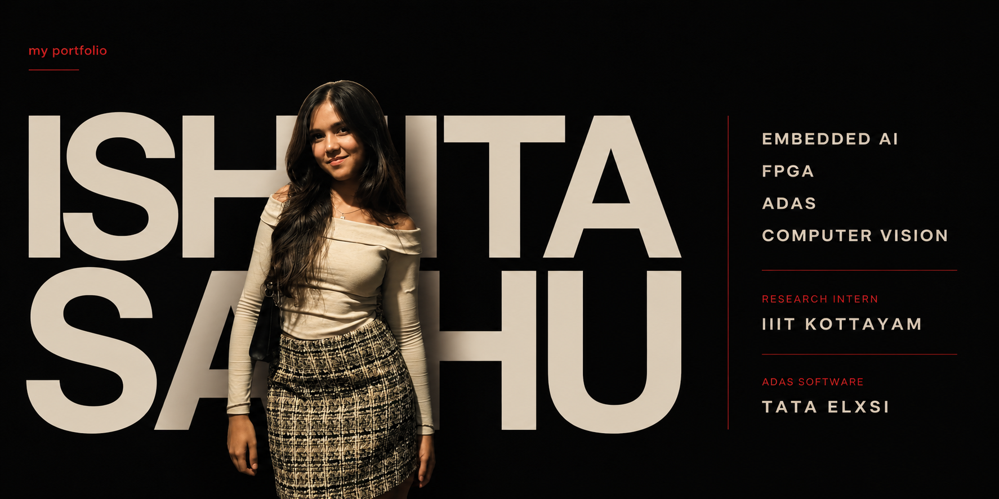

  

# ISHITA SAHU

### Embedded AI · FPGA · ADAS · Computer Vision

Electronics & Communication Engineering @ IIIT Kottayam

 

 

---

## ABOUT ME

I'm an **Electronics & Communication Engineering undergraduate at IIIT Kottayam** focused on building intelligent systems at the intersection of **machine learning, embedded systems, and hardware acceleration**.

My work spans from developing **embedded ADAS software** and real-time computer vision systems to researching **FPGA-based machine learning acceleration**.

I enjoy working close to the system — understanding how a model works, optimizing it, and thinking about how it can be efficiently deployed on real hardware.

Currently exploring:

`Embedded AI` · `Edge AI` · `FPGA Acceleration` · `ADAS` · `Computer Vision` · `Machine Learning`

---

# TECH STACK

### LANGUAGES

`Python` · `C` · `C++` · `Java` · `MATLAB` · `Verilog HDL`

---

### AI / MACHINE LEARNING

`PyTorch` · `TensorFlow` · `Scikit-learn` · `XGBoost` · `YOLO`

`Hugging Face` · `Sentence Transformers` · `Deep Learning` · `Signal Processing`

---

### FPGA / HARDWARE ACCELERATION

`FPGA` · `Vivado` · `Vitis` · `hls4ml` · `AXI`

`Xilinx Zynq` · `ESP32` · `Embedded Linux`

`Hardware-Software Co-Design` · `Quantization` · `Low-Latency Inference`

---

### EMBEDDED / ADAS

`C++` · `Python` · `OpenGL` · `PyQt5` · `UDP`

`Embedded Linux` · `Camera Systems` · `ADAS` · `Surround View Systems`

---

### AI SYSTEMS

`Google ADK` · `Gemini API` · `RAG` · `Multi-Agent Systems`

`SQL` · `REST APIs` · `Tool Calling` · `Agent Orchestration`

---

### DEVELOPMENT & TOOLS

`Git` · `GitHub` · `Docker` · `React` · `TypeScript`

`Node.js` · `Express.js` · `PostgreSQL` · `VS Code`

---

# EXPERIENCE

### TATA ELXSI

**Project Trainee — ADAS & Autonomous Driving**

`May 2026 — Present`

Working on embedded ADAS software and a **Surround View System**, including real-time camera switching, UDP communication, camera pose synchronization, OpenGL rendering, and embedded deployment across TI/Qualcomm platforms.

---

### SPHINX LAB · IIIT KOTTAYAM

**Research Intern — FPGA-Based ML Acceleration**

`May 2026 — Present`

Researching FPGA-based acceleration of ANN/CNN models using **hls4ml**, AXI-based custom IP, Xilinx Zynq platforms, quantization, and low-latency Edge AI inference.

---

# AREAS OF INTEREST

### Embedded AI
Building intelligent systems that bring machine learning closer to the edge.

### FPGA & Hardware Acceleration
Exploring neural-network acceleration, hardware-software co-design, and efficient inference on FPGA platforms.

### ADAS & Autonomous System
Interested in perception, camera systems, embedded visualization, and intelligent vehicle systems.

### Computer Vision
Real-time object detection, scene understanding, traffic intelligence, and vision-based embedded applications.

### Edge AI & TinyML
Deploying compact and optimized ML models on resource-constrained hardware.

### Machine Learning
Deep learning, model optimization, recommendation systems, and applied ML pipelines.

### Signal Processing & Brain-Computer Interface
Exploring EEG processing, SSVEP classification, and human-computer interaction.

### Intelligent Embedded Systems
Combining electronics, software, machine learning, and hardware to build practical intelligent systems.

---

# CURRENTLY LEARNING

`Hardware-Software Co-Design`

`Efficient ML Inference`

`FPGA Neural Network Acceleration`

`Edge AI Deployment`

`Advanced Computer Vision`

---

### BUILD. OPTIMIZE. DEPLOY.

 

[PORTFOLIO](https://portfolioishita-nine.vercel.app/)
&nbsp;&nbsp;·&nbsp;&nbsp;
[LINKEDIN](https://linkedin.com/in/ishita-sahu-8b3165326)

