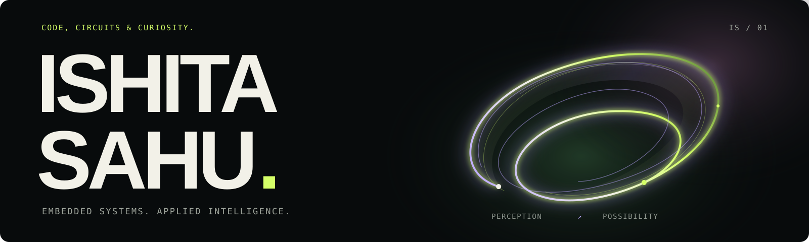

# Code, circuits & curiosity.

Hi, I’m **Ishita Sahu**, an Electronics & Communication Engineering undergraduate at **IIIT Kottayam (2024–2028)**. I work across embedded software, applied AI and hardware-aware machine learning. I like turning a signal or a model into something you can interact with.

[Portfolio ↗](https://portfolioishita-nine.vercel.app/) · [Resume overview](RESUME.md) · [LinkedIn](https://www.linkedin.com/in/ishita-sahu-8b3165326/) · [All builds](https://github.com/Ishita-2210?tab=repositories)

## Six things I’ve been building

### 01 / [SentinelAI](https://github.com/Ishita-2210/SentinelAI)

*A memory for video.* Object tracking becomes temporal events, saved keyframes and a local dashboard. FastAPI, SQLite, Florence-2 and SmolLM2 connect each observation to its source. [Inside the system →](https://github.com/Ishita-2210/SentinelAI/blob/main/docs/ARCHITECTURE.md)

### 02 / [Scout AI](https://github.com/Ishita-2210/scout-ai)

*Finding the next step in education.* A React workspace brings together six specialist domains, structured Groq responses, PDF references, web search and saved conversations. [Build notes →](https://github.com/Ishita-2210/scout-ai/blob/main/docs/AUDIT.md)

### 03 / [TeamForge — Talent-to-Team](https://github.com/Ishita-2210/teamforge-recommender)

*Skills meet relationships.* Teammate recommendations combine skill requirements, semantic caches and graph signals, with a weighted baseline and optional trained rankers. [Ranking and setup →](https://github.com/Ishita-2210/teamforge-recommender#ranking-and-optional-artifacts)

### 04 / [BlinkGrid Analytics](https://github.com/Ishita-2210/blinkgrid-analytics-dashboard)

*Support data, made legible.* PostgreSQL aggregation, an Express API and a React widget reveal recurring unresolved customer issues. [Follow the query →](https://github.com/Ishita-2210/blinkgrid-analytics-dashboard#sql-query)

### 05 / [Dynamic Parking Pricing](https://github.com/Ishita-2210/Capstone_iitg)

*Prices as data changes.* Occupancy and demand feed bounded pricing rules, pandas experiments and a Pathway CSV change-stream pipeline. [Run the stream →](https://github.com/Ishita-2210/Capstone_iitg#run-the-pathway-csv-pipeline)

### 06 / [Image Entropy Analyzer](https://github.com/Ishita-2210/image-entropy-analyzer)

*Looking closer at pixels.* A React workbench, FastAPI and a shared Python engine explore information theory, colour, spatial structure, frequency and actual codec comparisons. [Explore the workbench →](https://github.com/Ishita-2210/image-entropy-analyzer#what-works)

## Where I’m building

**Project Trainee — Embedded ADAS Software Engineering** 
Transportation Business Unit, Bengaluru · **May 2026–Present**

Python/C++ camera navigation and gesture interpolation, PyQt5/OpenGL interfaces, UDP pose synchronization and JSON-driven configuration for embedded Linux on Texas Instruments and Qualcomm platforms.

**Research Intern — FPGA-Based Machine Learning Acceleration** 
Sphinx Lab, IIIT Kottayam · **May 2026–Present**

Ongoing ANN/CNN inference research with hls4ml, quantization and custom AXI-interfaced IP for **Xilinx ZCU102**, using Vivado and MATLAB/Simulink.

## Technical toolkit

- **Languages:** Python · C/C++ · Verilog HDL · SQL · TypeScript/JavaScript · MATLAB
- **Embedded:** hls4ml · Vivado · AXI · ZCU102 · ESP32 · Embedded Linux
- **Models & perception:** PyTorch · TensorFlow · scikit-learn · XGBoost · NumPy/pandas/SciPy · YOLO/OpenCV
- **AI applications:** structured outputs · retrieval · Groq · Gemini/Google ADK · Serper · sentence embeddings
- **Interfaces & services:** React · FastAPI · Express · Flask · PostgreSQL · SQLite · Git · CMake · pytest

## More from the workshop

**Ongoing:** an EEG/SSVEP chess interface with FBCCA and ESP32 stimulation, and CCTV traffic-density/signal-control research with YOLO/OpenCV.

**Small experiments:** [Mini Google Search](https://github.com/Ishita-2210/Mini-Google-Search), [Aura](https://github.com/Ishita-2210/Aura---AI-Wellness-Companion), [BigQuery Release Hub](https://github.com/Ishita-2210/ishita-bigquery-release-hub), and the maths behind [linear regression](https://github.com/Ishita-2210/Linear_regression_scratch), [logistic regression](https://github.com/Ishita-2210/Logistic-Regression-Scratch) and a [NumPy neural network](https://github.com/Ishita-2210/2---Layer-Neural-Network-from-Scratch-).

**Maintained forks:** [Green Fleet Optimizer](https://github.com/Ishita-2210/green-fleet-optimizer), from [nidhiiiii0707](https://github.com/nidhiiiii0707/green-fleet-optimizer), and [microplastics visualization](https://github.com/Ishita-2210/nanoparicle_simulation), from [vasu-era](https://github.com/vasu-era/nanoparicle_simulation).

Away from the builds: **Beta Labs (AI/ML) core member**, **Placement Cell Coordinator**, and **TEDx IIIT Kottayam PR & Outreach**.

---

Have a look around. Start with a build, visit the [portfolio](https://portfolioishita-nine.vercel.app/), or read my [resume overview](RESUME.md).
